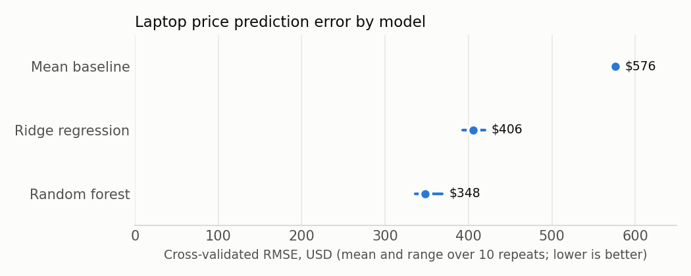

# Laptop Price Prediction

How well do a laptop's specifications (CPU, RAM, GPU, screen, weight, brand, category) predict its listed price? A retailer or buyer comparing listings needs to know both the typical error and how wide an honest price range is. This started as IBM *Data Analysis with Python* coursework and is extended here with grouped, nested cross-validation, a nonlinear model and conformal prediction intervals.

## Key results

238 laptops, prices from $527 to $3,810 (median $1,333). Cross-validated over 10 repeats of grouped 5-fold CV:

| Model | RMSE (USD) | MAE (USD) | R² |
|---|---:|---:|---:|
| Random forest | **348** (range 336 to 369) | 250 | 0.63 |
| Ridge regression | 406 (range 393 to 420) | 292 | 0.50 |
| Mean baseline | 576 | 445 | -0.01 |

A split-conformal 90% prediction interval for the random forest is ±$959 wide and covered 46 of 48 held-out laptops (95.8%).



The random forest cuts error by about 40% against predicting the average price and by about 14% against ridge regression, which points to interactions among specs that a linear model misses. Still, a ±$959 interval on a median $1,333 laptop means specifications alone leave much of the price unexplained.

## Approach

- **scikit-learn `Pipeline`** with median imputation, standardization and one-hot encoding, so all preprocessing is learned inside each training fold.
- **Grouped cross-validation:** 24 rows share every specification with another row. Identical configurations are kept in one group so they never appear in both training and validation folds.
- **Nested CV:** an inner grouped 5-fold `GridSearchCV` tunes ridge `alpha` and random forest `min_samples_leaf` and `max_features`, and an outer grouped 5-fold loop, repeated 10 times with different shuffles, scores the whole procedure.
- **Baseline:** a mean-price predictor, so every error is read against "no model".
- **Split-conformal prediction intervals:** fit on 60%, calibrate the 90% residual quantile on 20% and check coverage once on the final 20%, splitting by specification group.

## Data

The IBM Skills Network *Laptop Pricing Dataset* ([CSV](https://cf-courses-data.s3.us.cloud-object-storage.appdomain.cloud/IBMDeveloperSkillsNetwork-DA0101EN-Coursera/laptop_pricing_dataset_base.csv)), retrieved 2026-09-14 and re-verified unchanged 2026-10-23. The checksum is in [`data/SOURCES.json`](data/SOURCES.json). IBM distributes it as course material without a separate license, and it doesn't document its collection date or market.

- **Unit:** one laptop configuration and its listed price in USD.
- **n:** 238 rows, 226 distinct specifications. 4 screen sizes and 5 weights are missing.
- **Encoding:** `Category`, `GPU` and `OS` arrive as integer codes and are treated as categories. `CPU_core` (3, 5, 7 for Core i3, i5, i7) is treated as numeric.

## Repository structure

```text
analysis.py              # data contract, grouping, nested CV, conformal interval, figure
laptop_pricing.ipynb     # EDA and walkthrough of the results
data/raw/                # laptop_pricing_dataset_base.csv
data/SOURCES.json        # URL and checksum
outputs/                 # metrics.json, cv_comparison.csv, test_predictions.csv, coefficients.csv, figures/
tests/test_analysis.py
```

## Reproduce

```bash
python3.12 -m venv .venv && source .venv/bin/activate
pip install -r requirements.txt
pytest -q
python analysis.py          # about one minute; rewrites outputs/
jupyter nbconvert --to notebook --execute --inplace laptop_pricing.ipynb
```

## Limitations

- 238 laptops is small. The held-out 48 give a coverage check, not a precise one, and the random forest's RMSE on that one split ($463) is noisier than the cross-validated estimate.
- The source doesn't say when, where or how prices were collected, so the model describes this dataset, not today's market.
- Several categories are tiny (one Razer, one Huawei, one Xiaomi), so their effects can't be estimated reliably.
- Coefficients and feature effects are associations within this sample, not causal price effects.
